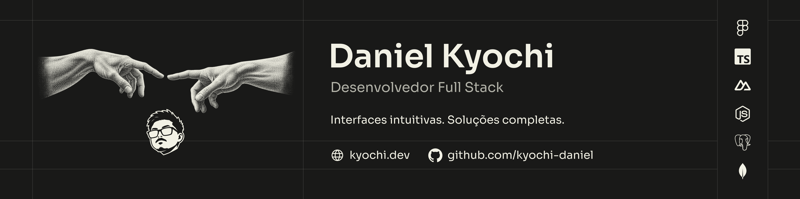

### Olá, sou o Daniel 👋

Sou desenvolvedor full stack, autônomo desde 2020, com foco em **IA aplicada e engenharia de aplicações com LLMs**. Crio interfaces, sistemas e automações e integro modelos de linguagem a fluxos de trabalho e dados de negócio.

Na pós-graduação em Engenharia de IA Aplicada, desenvolvo projetos acadêmicos que exploram **RAG, memória conversacional, saídas estruturadas, workflows com LangGraph e integração de ferramentas via MCP**. Também estudo machine learning com TensorFlow.js e scikit-learn, incluindo treinamento, avaliação de recomendadores e classificadores de texto e publicação de modelos no Hugging Face.

- **Desenvolvimento:** TypeScript, JavaScript, Vue, Nuxt, Node.js e React.
- **IA e LLMs:** LangChain, LangGraph, OpenRouter, RAG, embeddings, MCP e TensorFlow.js.
- **Dados:** PostgreSQL, MongoDB, Neo4j e SQLite.
- **Observabilidade:** OpenTelemetry, Grafana, Prometheus, Loki e Tempo em laboratórios de diagnóstico de incidentes.
- **Também utilizo:** Figma, Git e VS Code.
- **Formação:** pós-graduação em Engenharia de IA Aplicada na [Unipds](https://unipds.com.br/) em andamento; estudos de desenvolvimento web na [Rocketseat](https://rocketseat.com.br/).

### Modelos publicados no Hugging Face

**Delivery Match** — recomendador acadêmico de refeições que combina histórico de pedidos, avaliações e comportamento simulado. Modelo treinado com scikit-learn, avaliação temporal e comparação com baselines. Todos os dados são sintéticos; os resultados não representam clientes reais.

[🤗 Ver modelo e métricas](https://huggingface.co/kyochi-daniel/delivery-match-academico) · [Experimentar a demonstração](https://huggingface.co/spaces/kyochi-daniel/delivery-match-demo) · [Código e treinamento](https://github.com/kyochi-daniel/delivery-match-academico)

**Modelo para detecção de prompt injection** — treinamento de um classificador de texto em português para identificar possíveis tentativas de manipular instruções de agentes de IA. Usa dados sintéticos, avaliação por famílias e comparação com regras simples. A demonstração mostra os sinais da classificação e os erros observados; não é uma proteção pronta para produção.

[🤗 Ver modelo e avaliação](https://huggingface.co/kyochi-daniel/deteccao-prompt-injection) · [Experimentar a demonstração](https://huggingface.co/spaces/kyochi-daniel/deteccao-prompt-injection-demo) · [Código e treinamento](https://github.com/kyochi-daniel/deteccao-prompt-injection)

### Projetos de IA em destaque

- [Assistente analítico com Neo4j](https://github.com/kyochi-daniel/assistente-analitico-neo4j) — perguntas em linguagem natural convertidas em consultas Cypher, com limites de execução e testes offline.
- [Assistente com memória persistente](https://github.com/kyochi-daniel/assistente-memoria-persistente) — preferências em SQLite, checkpoints PostgreSQL e sumarização do histórico.
- [Agendamento assistido por LLM](https://github.com/kyochi-daniel/agendamento-assistido-llm) — interpretação estruturada de pedidos e execução de regras de agendamento em um workflow LangGraph.
- [Diagnóstico de incidentes com Grafana e MCP](https://github.com/kyochi-daniel/diagnostico-incidentes-grafana-mcp) — correlação de logs, métricas e traces em um cenário reproduzível.
- [Recomendador com TensorFlow.js](https://github.com/kyochi-daniel/recomendador-tensorflowjs) — preparação de dados, treinamento de rede neural e recomendação de produtos no navegador.

Os projetos desta lista foram realizados para fins acadêmicos, com base no material da pós-graduação. O Delivery Match e o modelo para detecção de prompt injection são estudos independentes. Cada repositório documenta sua origem, adaptações, forma de execução e limitações.

[Portfólio](https://www.kyochi.dev/) · [LinkedIn](https://www.linkedin.com/in/daniel-kyochi/)
